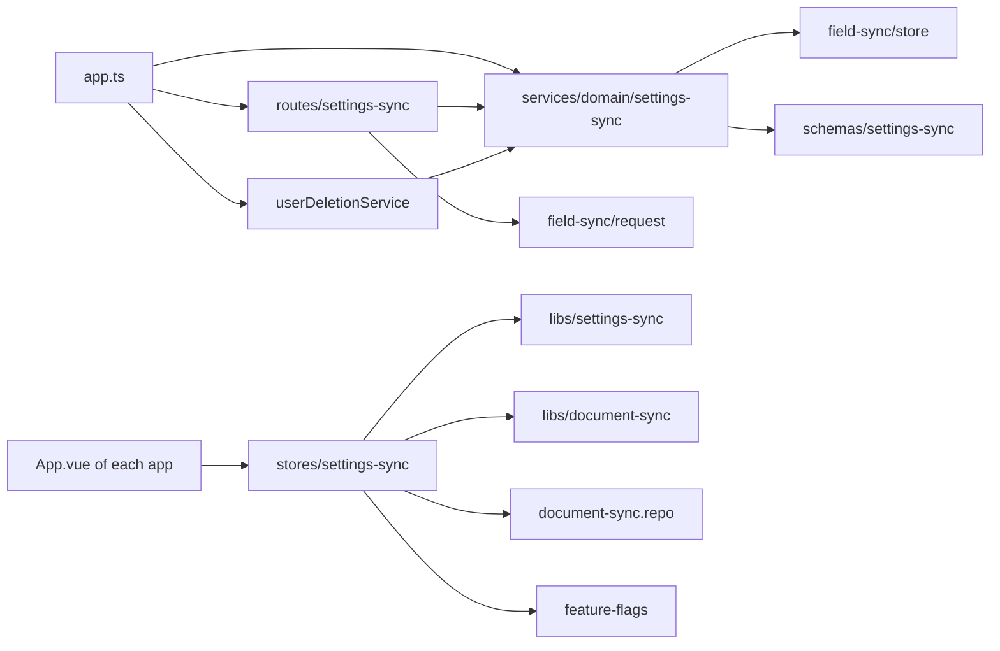
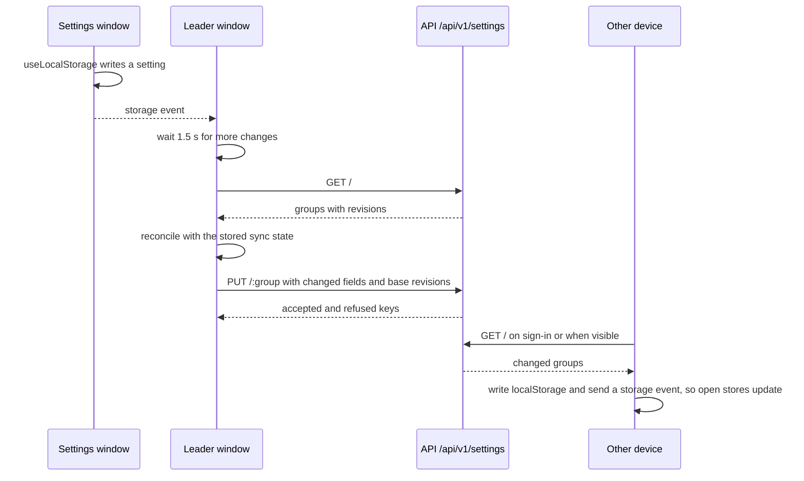

# Settings synchronization

Status: accepted

## Context

The stage apps keep their settings in `localStorage`, about 160 keys in 30 stores.
The desktop app and the web app have different storage, so each device has its own settings.
The owner of a self-hosted server wants the same settings on every device.

Chats already synchronize through the chat WebSocket. Character cards synchronize through the field store of `2026-10-06-document-sync.md`.
Settings are small values that one user changes on several devices. The field store fits them.

## Decision

Add a `settings` feature to the resource API. It uses `createFieldSyncStore` like character cards.

- A document is one settings group, for example `speech` or `live2d`. The client owns the list of groups.
- A field key is the `localStorage` key, for example `settings/speech/voice`.
- A field value is the raw `localStorage` string. The server and the sync code do not read the setting types.
- The client synchronizes only the keys in an allow list. The list leaves out:
  - Secrets, for example API keys, tokens, and the voiceprint. The field store keeps values as plain JSON.
  - Values that belong to one device, for example audio devices, window placement, render quality, and connection addresses.
  - Features that must run on one device only, for example the Discord bot and missions.
- The renderer leader runs a sync 1.5 seconds after a local change, on sign-in, and when the experiment turns on. It also reads the server when the page becomes visible or the window becomes the leader, at most once each 10 seconds. A hidden tab can report these events many times in a row.
- On a conflict, the server value applies. A settings group has a fixed id, so the client keeps no conflict copy.
- A new device that has only default values takes the server values on its first run.
- Synchronization is a client-owned experiment, `settings-sync`, off by default.
- A server outside `airi.build` has no AIRI Cloud unless `VITE_CLOUD_URL` names one. Before this rule, the client sent the token of a self-hosted server to the hosted Cloud. The Cloud answered 401, and `authedFetch` ended the session, so every sign-in ended in a sign-out.

## Scope

- Tables `synced_settings` and `synced_settings_fields`, and route `/api/v1/settings`.
- Routes `GET /`, `PUT /:id`, and `DELETE /:id`. Settings have no history UI, so the route has no history routes.
- The store keeps a short history, so a later history UI can read it.
- Account deletion removes the settings of the account.
- The client allow list, the synchronization store, the experiment flag, and a self-hosting guide in `server/README.md`.

## Non-goals

- Provider credentials and other secrets. A later design can add them with encryption.
- Memories, recipes, and missions. The memory and sync ADR handles them, together with the rule that one device runs missions.
- Live updates from the server. A device synchronizes after a local change, on sign-in, and when it becomes visible.
- Phone access to a self-hosted server. It needs HTTPS, for example through a private network tunnel.

## Limits

| Setting | Value | Reason |
| --- | --- | --- |
| Documents | 32 | The client has about 10 groups. |
| Field value bytes | 1 MiB | The allowed settings take a few kilobytes. |
| One value | 64 KiB as JSON text | A setting is a short string. A larger value is an error. |
| Revisions for each key | 20 | Enough to undo recent changes. |
| History bytes | 4 MiB | Bounds the history of one account. |
| Deleted group retention | 30 days | Same as character cards. |

The validator accepts a key of letters, digits, `/`, `-`, `_`, and `.`, and a string value. It does not know the allow list, so a client can add a group without a server change.

## Module dependency graph



## Affected files

```text
server/
  apps/api/
    drizzle/00xx_synced_settings.sql            (new, generated)
    src/app.ts                                  (wire the service, route, and deletion)
    src/schemas/index.ts                        (export the tables)
    src/schemas/settings-sync.ts                (new)
    src/services/domain/settings-sync.ts        (new)
    src/routes/settings-sync/index.ts           (new)
    src/routes/settings-sync/route.test.ts      (new)
  docs/ai/adr/2026-10-31-settings-sync.md       (new)
  docker-compose.yaml                           (health checks use 127.0.0.1)
  README.md                                     (self-hosting guide)
packages/
  stage-ui/src/libs/settings-sync/              (new: allow list and field mapping)
  stage-ui/src/stores/settings-sync.ts          (new)
  stage-ui/src/libs/feature-flags.ts            (new flag)
  stage-ui/src/composables/cloud.ts             (no Cloud for a self-hosted server)
  stage-ui/src/stores/{feature-flags,inbox}.ts  (skip Cloud requests without a Cloud)
  i18n/src/locales/{en,ja}/settings.yaml        (flag text)
apps/
  stage-web/src/App.vue                         (start the store)
  stage-tamagotchi/src/renderer/App.vue         (start the store)
```

## Sequence



## Test plan

- Route tests with the mock database: no user, push and list, invalid keys and values, the value size limit, and deletion.
- Client unit tests: the allow list leaves out secrets and device values, and the field mapping reads and writes raw strings.
- Client browser test: a received value reaches `localStorage` and an open `useLocalStorage` ref in the same window.
- Client browser test: a self-hosted server has no Cloud.
- Manual test against `pnpm dev:backend`: change a setting in the desktop app and see it in the web app.
