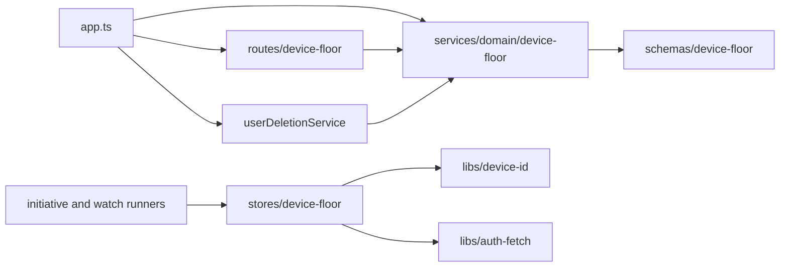
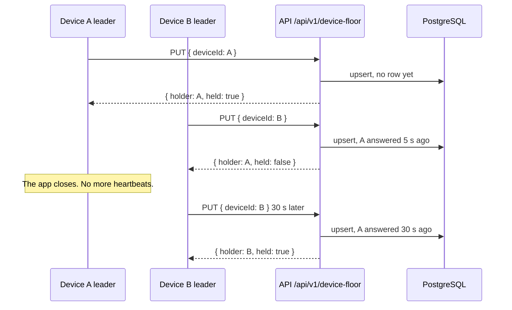

# Device floor

Status: proposed

## Context

[ADR 2026-11-02](../../../docs/ai/adr/2026-11-02-long-term-memory-and-recall.md) lets one owner use the character on several devices with the same memories. Step M4 of that ADR adds the floor: only one device runs autonomous speech and missions, so two devices never speak the same line.

- The device that connected first holds the floor until it stops. Then the next device takes it.
- A reply to an owner message plays on the device where the owner sent it. The floor does not change that.
- The API has no background loops, and it runs as several instances. The floor must work inside the request thread.
- The chat WebSocket keeps its connections in the memory of one process, so it cannot tell the devices of an account across instances.

## Decision

Add a `device-floor` feature to the resource API. One row for each account says which device holds the floor and when it last answered.

- `PUT /api/v1/device-floor` with `{ deviceId }` claims or keeps the floor. One conditional upsert decides it:
  - Without a row, the device takes the floor.
  - The holder keeps it, and its heartbeat moves to now.
  - Another device takes it only when the heartbeat of the holder is 30 seconds old or more.
- The answer is `{ holder, held, heartbeatAt }`. `held` tells whether the calling device holds the floor now.
- `DELETE /api/v1/device-floor/:deviceId` gives the floor up, for example when the app closes. It deletes the row only when that device holds it.
- PostgreSQL keeps the row. The floor is not money, but a row in the database keeps the one source of truth of the API, and the upsert is atomic across instances.
- The client sends a heartbeat every 10 seconds from its renderer leader, so a closed device loses the floor after 30 seconds.
- The device id is a random UUID of the client. It is not a secret, and it says nothing about the device.

## Scope

- Table `device_floor` and its migration.
- Routes `PUT /api/v1/device-floor` and `DELETE /api/v1/device-floor/:deviceId`.
- Account deletion removes the row.

## Non-goals

- A list of all devices of an account. The floor needs only the holder.
- Live updates. A device learns of a change with its next heartbeat.
- Handover by the owner, for example "speak on this device now". A later change can add it.

## Limits

| Setting | Value | Reason |
| --- | --- | --- |
| Heartbeat of the client | 10 seconds | Three heartbeats fit in the takeover time. |
| Takeover time | 30 seconds | A closed device loses the floor soon, and a short network gap does not move it. |
| Device id | 1 to 64 characters of letters, digits, and `-` | A UUID fits. |

## Module dependency graph



## Affected files

```text
server/
  apps/api/
    drizzle/00xx_device_floor.sql                  (new, generated)
    src/app.ts                                     (wire the service, routes, and deletion)
    src/schemas/index.ts                           (export the table)
    src/schemas/device-floor.ts                    (new)
    src/services/domain/device-floor.ts            (new)
    src/routes/device-floor/index.ts               (new)
    src/routes/device-floor/route.test.ts          (new)
  docs/ai/adr/2026-11-02-device-floor.md           (new)
packages/
  stage-ui/src/libs/device-id.ts                   (new)
  stage-ui/src/stores/device-floor.ts              (new)
  stage-ui/src/stores/{initiative,watch}-runner.ts (run only with the floor)
```

## Sequence



## Test plan

- Route tests with the mock database and a fake clock: the first device takes the floor, the holder keeps it, another device waits, and it takes over after 30 seconds.
- A release by the holder deletes the row, and a release by another device changes nothing.
- The floor of one account does not reach another account.
- Invalid device ids answer 400, and a request without a user answers 401.
- Account deletion removes the row.
