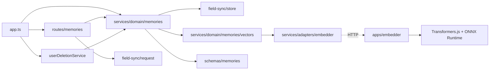
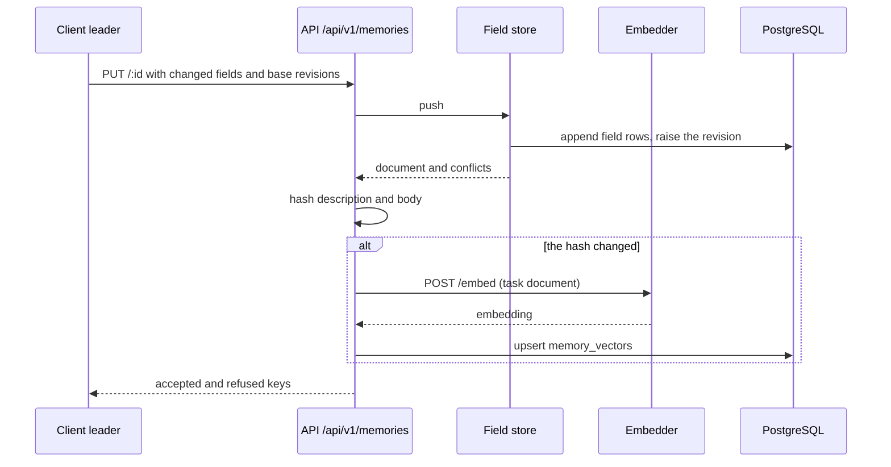
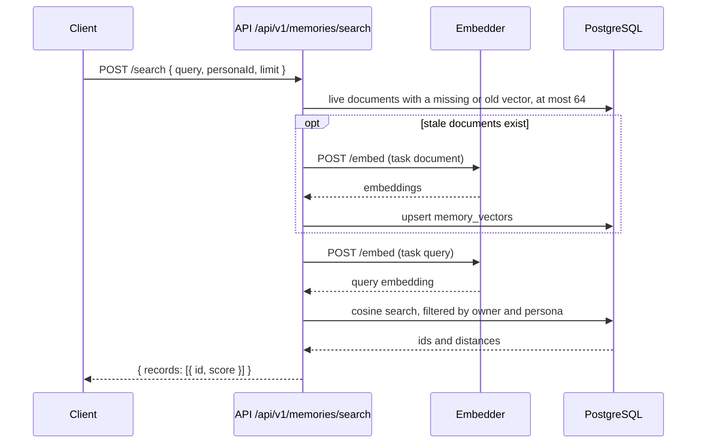

# Memory store and search by meaning

Status: proposed

## Context

[ADR 2026-11-02](../../../docs/ai/adr/2026-11-02-long-term-memory-and-recall.md) makes the server the source of truth for the long-term memories of the character. Step M1 of that ADR is this server part.

- The client keeps each memory as one entry: an index line (`description`), a `body`, and the character card that owns it (`persona`). A general entry has no card.
- The client needs to find entries by meaning, also in Japanese. Character pairs find only shared words.
- The database already loads VectorChord (`server/apps/api/sql/init.sql`), which also installs the `vector` type.
- The API has no background loops. Every business write happens in the request thread.

## Decision

Add a `memories` feature to the resource API, and a separate `embedder` service that turns text into vectors.

### The memory feature

- It uses `createFieldSyncStore`, like character cards and settings. A document is one entry, and its id is the UUIDv7 that the client made.
- The fields are `description`, `body`, and `persona`. The validator checks them: `description` is a string of 150 characters at most, `body` is a string of 1 to 2,000 characters, and `persona` is a string of 1 to 128 characters. A general entry has no `persona` field.
- A table `memory_vectors` keeps one vector for each live document: the owner, the document id, the persona, the hash of the embedded text, the model name, and a `vector(256)`.

### Vectors in the request thread

- After an accepted push, the route embeds the document again when the hash of `description` and `body` changed. It writes the vector in the same request.
- If the embedder fails, the push still succeeds. The text is the truth, and the vector row stays old or missing.
- A search first embeds the stale or missing documents of the account, at most 64 in one batch. Then it searches. A first search after an import can therefore take longer, and later searches are fast.
- A document deletion also deletes its vector row.

### Search

- The search compares the query vector with the vectors of the account, filtered to the given persona and the general entries.
- One account holds some thousands of entries. An exact cosine search over its rows is fast enough, so M1 adds no approximate index. A `vchordrq` index comes when one account passes about 50,000 entries.
- The score is `1 - cosine distance`. The route returns the best results first.

### The embedder service

- `server/apps/embedder` is a small Hono app. It loads EmbeddingGemma 2 with Transformers.js and ONNX Runtime for Node, with q8 weights and the text path only. The text weights take about 314 MB.
- Transformers.js supports EmbeddingGemma 2 from 4.3.1. The workspace catalog has 3.8.1 for the apps, so the `package.json` of the embedder pins 4.3.2. A second catalog entry of one package fails the lint rule `pnpm/yaml-no-duplicate-catalog-item`.
- The image is Debian, not Alpine, because the binaries of ONNX Runtime for Node need glibc.
- It downloads the model once into a Docker volume. It listens only after the model loads, so its health check also tells that the model is ready.
- `POST /embed` takes `{ texts, task }` and returns `{ records: [{ embedding }] }`. Each embedding has 256 dimensions and is normalized.
- `task` selects the prefix: `query` gives `task: search result | query: `, `document` gives `title: none | text: `, and `similarity` gives `task: sentence similarity | query: `.
- It runs one batch at a time, so a large import does not starve a search of CPU for long. A batch holds 32 texts at most.
- It listens only on the internal network of Docker Compose. Caddy does not route to it.
- The API reads its address from `EMBEDDER_URL`. Without the variable, the search and embed routes answer `503 EMBEDDER_UNAVAILABLE`, and the client recalls by character pairs. The hosted deployment does not run an embedder.

## Scope

- Tables `memories`, `memory_fields`, and `memory_vectors`, and their migration.
- Routes under `/api/v1/memories`:
  - `GET /`, `PUT /:id`, and `DELETE /:id`, as the field store defines them.
  - `POST /search` with `{ query, personaId, limit }`. It returns `{ records: [{ id, score }] }`. `query` has 1 to 500 characters, and `limit` is 1 to 20, 5 by default.
  - `POST /embed` with `{ texts }` for the similarity of topic labels. It returns `{ records: [{ embedding }] }`. It takes 1 to 32 texts of 200 characters at most.
- The `embedder` app, its Dockerfile, and its service in `server/docker-compose.yaml`.
- Account deletion removes the memories and their vectors.

## Non-goals

- Embeddings of images, audio, or screens.
- A queue or a background worker for embeddings.
- An approximate vector index.
- Memories shared between accounts.
- The presence record for the floor between devices. Step M4 adds it.

## Limits

| Setting | Value | Reason |
| --- | --- | --- |
| Documents | 5,000 | A personal memory has some hundreds of entries after months. |
| Field value bytes | 16 MiB | 5,000 entries of 2,000 characters in UTF-8, with room. |
| Revisions for each key | 5 | Enough to undo a recent change. Memories have no history UI. |
| History bytes | 8 MiB | Bounds the history of one account. |
| Deleted entry retention | 30 days | Same as character cards and settings. |
| Embed batch | 32 texts | Keeps one batch short on a CPU. |
| Stale vectors embedded by one search | 64 | Bounds the delay of one search. |

## Module dependency graph



## Affected files

```text
server/
  apps/api/
    drizzle/00xx_memories.sql                      (new, generated)
    src/app.ts                                     (wire the service, routes, and deletion)
    src/libs/env.ts                                (optional EMBEDDER_URL)
    src/schemas/index.ts                           (export the tables)
    src/schemas/memories.ts                        (new)
    src/services/adapters/embedder.ts              (new: HTTP client with a timeout)
    src/services/domain/memories/index.ts          (new: field store and validator)
    src/services/domain/memories/vectors.ts        (new: hash, stale rows, search)
    src/services/domain/memories/*.test.ts         (new)
    src/routes/memories/index.ts                   (new)
    src/routes/memories/route.test.ts              (new)
  apps/embedder/                                   (new app)
    package.json, Dockerfile, README.md, vitest.config.ts
    src/main.ts, src/app.ts, src/model.ts, src/prefix.ts
    src/scripts/check-model.ts                     (manual check with the real model)
    src/*.test.ts
  docker-compose.yaml                              (embedder service and model volume)
  docs/ai/adr/2026-11-02-memory-store-and-search.md (new)
  README.md                                        (self-hosting guide: the embedder)
```

## Sequence

A write from a device:



A search:



## Test plan

- Route tests with the mock database: no user, push and list, invalid fields, the size limits, deletion, and account deletion.
- Vector tests with a fake embedder: a changed hash embeds again and an unchanged one does not, a failed embedder keeps the push, a search embeds stale rows first, and the persona filter keeps other cards out.
- Route tests for `503 EMBEDDER_UNAVAILABLE` without `EMBEDDER_URL` and when the embedder fails.
- Embedder unit tests: the prefix of each task, the cut to 256 dimensions, and the normalization. They use a fake model.
- A manual test against `pnpm dev:backend` with the real model: Japanese entries are found by questions that share no words with them.
- `pnpm -F @proj-airi/embedder-server check:model` loads the real model and ranks Japanese entries for questions that share no words with them. In step M1 it found 4 of 4.
