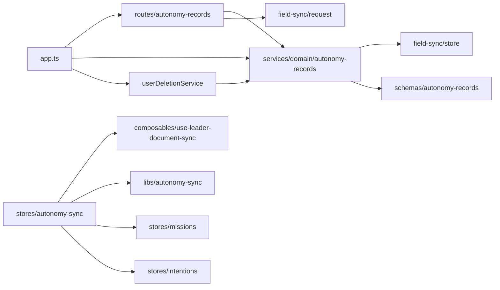
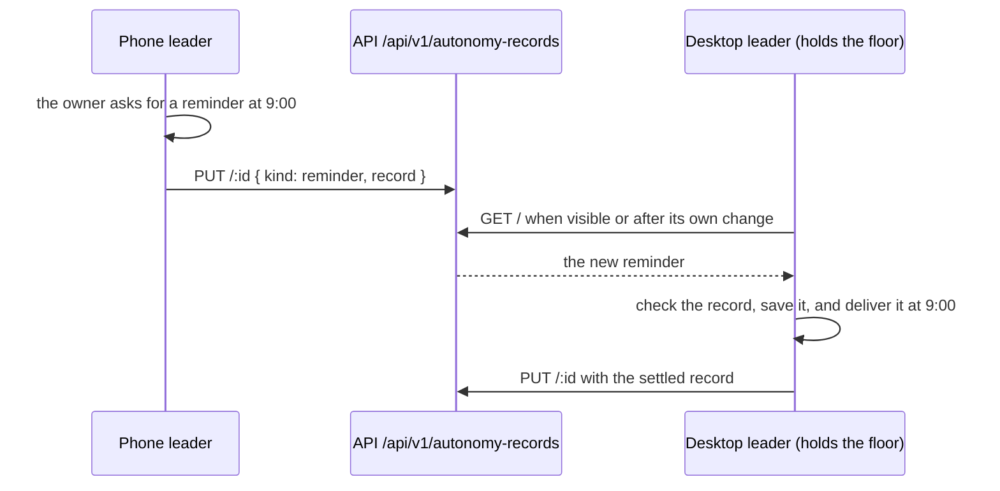

# Autonomy records

Status: proposed

## Context

[ADR 2026-11-02](../../../docs/ai/adr/2026-11-02-long-term-memory-and-recall.md) lets one owner use the character on several devices. Step M4a gave the floor to one device. Step M4b syncs the reminders and intentions, so the device that holds the floor runs them, wherever the owner asked for them.

- Reminders and intentions are small JSON objects that the client defines in `packages/core-agent`.
- The server does not need their shape. It only stores and syncs them.
- Small talk, commentary, and watches belong to the screen of one device, so they do not sync.

## Decision

Add an `autonomy-records` feature to the resource API. It uses `createFieldSyncStore`, like character cards, settings, and memories.

- A document is one reminder or one intention. Its id is the id of the record, which the client made.
- The fields are `kind`, which is `reminder` or `intention`, and `record`, a JSON object of 16 KiB at most.
- The validator checks only the keys, the kind, and the size. The client checks the record with a Valibot schema when it receives it, because the server does not know the shape.
- One feature holds both kinds, so the client syncs them in one run.

## Scope

- Tables `autonomy_records` and `autonomy_record_fields`, and their migration.
- Routes `GET /`, `PUT /:id`, and `DELETE /:id` under `/api/v1/autonomy-records`.
- Account deletion removes the records.

## Non-goals

- Small talk, commentary, and watches.
- A check of the record on the server.
- A history UI.

## Limits

| Setting | Value | Reason |
| --- | --- | --- |
| Documents | 2,000 | Reminders and intentions stay few. |
| Field value bytes | 4 MiB | 2,000 records of some hundred bytes fit with room. |
| One record | 16 KiB as JSON text | A reminder or an intention is a short object. |
| Revisions for each key | 5 | Enough to undo a recent change. |
| History bytes | 4 MiB | Bounds the history of one account. |
| Deleted record retention | 30 days | Same as the other synced features. |

## Module dependency graph



## Affected files

```text
server/
  apps/api/
    drizzle/00xx_autonomy_records.sql              (new, generated)
    src/app.ts                                     (wire the service, routes, and deletion)
    src/schemas/index.ts                           (export the tables)
    src/schemas/autonomy-records.ts                (new)
    src/services/domain/autonomy-records.ts        (new)
    src/routes/autonomy-records/index.ts           (new)
    src/routes/autonomy-records/route.test.ts      (new)
  docs/ai/adr/2026-11-03-autonomy-records.md       (new)
packages/
  stage-ui/src/composables/use-leader-document-sync.ts (new: the run loop of memories and records)
  stage-ui/src/libs/autonomy-sync/                 (new: fields and checks)
  stage-ui/src/stores/autonomy-sync.ts             (new)
  stage-ui/src/stores/{missions,intentions}.ts     (apply a sync round)
  stage-ui/src/stores/mission-runner.ts            (deliver only with the floor)
```

## Sequence



## Test plan

- Route tests with the mock database: no user, push and list, deletion, the owner filter, an unknown kind or key, a record that is not an object, a record over the limit, and account deletion.
- Client unit tests: the fields of each kind, the check of each record, and the split of removals by kind.
- Client browser tests: a round of reminders keeps the other missions, a round of intentions reaches other windows, and only reminders and intentions leave the device.
